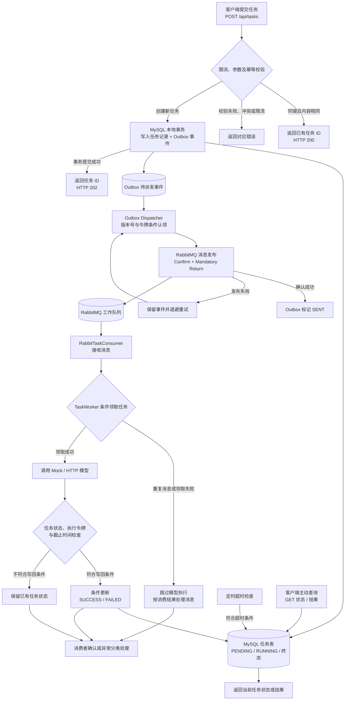
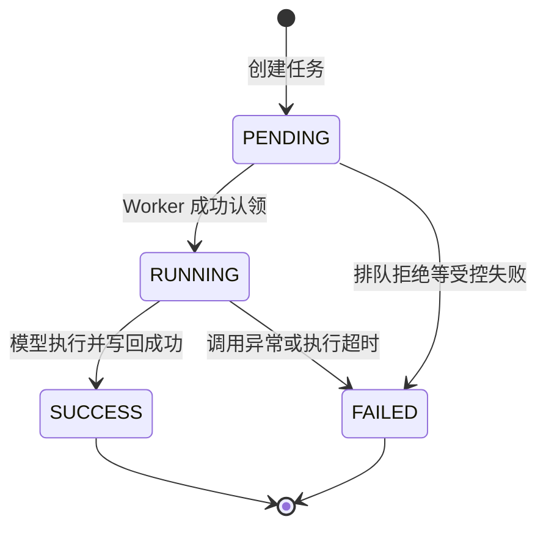

# Asynchronous AI Task Orchestration Platform

**大模型异步任务处理平台**

基于 **Java 17 + Spring Boot** 构建的异步 AI 任务处理平台。通过任务幂等受理、后台执行、MySQL 持久化、Transactional Outbox 与 RabbitMQ 消息派发，将耗时的模型请求拆分为**任务提交、后台处理和结果查询**三个环节；结合 Worker 条件领取、执行令牌与超时检查，保证任务状态按预期流转。

## 项目介绍

在企业 AI 助手、文本摘要和内容处理等场景中，模型响应时间通常长于普通业务接口。若使用同步调用，客户端需要一直等待模型返回，也不便于处理重复提交、并发执行、消息派发失败与任务超时。

本项目提供统一的任务 API：客户端提交文本任务后获取任务 ID，后台 Worker 调用 Mock 或 OpenAI-compatible HTTP 模型接口，执行结果写入任务仓库；客户端通过独立接口查询任务状态和结果。

核心能力包括：

- **任务幂等受理**：规范化输入，使用数据库唯一约束处理并发重复提交。
- **异步任务执行**：支持本地有界线程池及 RabbitMQ 消息消费模式。
- **可靠消息派发**：使用 Transactional Outbox、发布确认和退避重试管理任务事件。
- **并发状态保护**：通过条件更新竞争执行权，防止重复消息触发无条件重复执行。
- **超时与结果保护**：结合执行令牌、截止时间和超时扫描，拒绝迟到 Worker 覆盖任务终态。
- **流量和模型错误控制**：使用 Redis Lua 原子限流，统一处理模型调用超时、异常响应和任务失败。

## 技术栈

| 技术 | 用途 |
|---|---|
| Java 17 | 核心业务逻辑、并发执行与 HTTP 模型适配 |
| Spring Boot 3.5.x | REST API、组件配置与依赖管理 |
| Spring JDBC、MySQL 8 | 任务持久化、幂等约束、状态条件更新与 Outbox |
| Spring AMQP、RabbitMQ | 消息派发、发布确认与消费者手动 ACK |
| Redis、Lua | 基于请求来源的原子固定窗口限流 |
| Java HttpClient | OpenAI-compatible 模型 HTTP 接口调用 |
| JUnit Jupiter、Maven | 自动化测试、构建与验证 |

具体依赖版本见 [`pom.xml`](pom.xml)。

## 架构与执行流程

平台将 **HTTP 任务受理、消息派发、Worker 执行、状态持久化和客户端查询** 分开处理。下面以 **MySQL + Transactional Outbox + RabbitMQ** 模式展示完整业务链路。



### 三种任务派发方式

| 模式 | 执行路径 | 使用场景 |
|---|---|---|
| **本地模式** | 任务受理 → 有界线程池 → TaskWorker | 默认开发、功能验证与 Mock 测试 |
| **RabbitMQ 模式** | 任务持久化 → RabbitMQ 发布 → Consumer → TaskWorker | 消息队列驱动的异步执行 |
| **Outbox + RabbitMQ 模式** | MySQL 同事务写入任务和事件 → Outbox Dispatcher → RabbitMQ → TaskWorker | 持久化任务与可靠派发 |

默认配置为 `memory/local/mock`，使用内存存储、有界线程池和 Mock 模型。启用持久化消息模式后，任务由 MySQL 保存，Outbox Dispatcher 负责事件派发，RabbitMQ Consumer 负责消息消费。

**任务提交与结果查询相互独立**：任务受理接口返回 ID 后，Worker 在后台执行；客户端可随时使用 GET 接口读取 `PENDING`、`RUNNING` 或终态结果。

### 任务状态流转



## 核心实现

### 1. 任务提交与幂等处理

`TaskService` 接收任务内容和幂等键，对输入进行规范化，并由 `TaskRepository` 完成任务注册。

- **首次提交**：创建 `PENDING` 任务并返回任务 ID。
- **相同幂等键、相同输入**：复用已有任务并返回原任务 ID。
- **相同幂等键、不同输入**：返回 HTTP 409 冲突响应。

在 MySQL 模式中，使用唯一约束协调并发插入，通过数据库冲突结果识别重复请求，避免多个并发请求创建相同任务。

### 2. Transactional Outbox 可靠派发

在持久化消息模式下，任务记录和 Outbox 事件在**同一个 MySQL 本地事务**中写入。

`JdbcTaskRepository` 负责持久化，`OutboxDispatcher` 通过版本号条件更新和认领令牌取得待发事件的处理权，再调用 RabbitMQ Publisher 发送消息。

- **发布成功**：收到发布确认后，将事件条件更新为 `SENT`。
- **发布失败**：保留事件，通过退避策略再次派发。
- **消息重复到达**：由 TaskWorker 的任务状态条件领取控制有效执行。

这套流程将数据库持久化、消息发送与任务执行分为独立阶段，使用至少一次派发与幂等领取协同处理重试和重复消息。

### 3. RabbitMQ 消费与 Worker 执行权管理

`RabbitTaskConsumer` 负责接收消息、手动 ACK 与异常分类。`TaskWorker` 负责实际任务执行。

Worker 收到任务后，先使用数据库条件更新将 `PENDING` 任务领取为 `RUNNING`。只有领取成功的 Worker 才调用模型。

当多个 Worker 收到同一任务消息时，数据库只允许满足领取条件的执行者更新任务状态；其他消费者按当前任务状态处理消息。模型执行完成后，再通过条件更新写回终态，确保任务结果与当前状态一致。

### 4. 执行期限与迟到结果保护

启用执行期限后，Worker 领取任务时建立执行令牌和截止时间，并在写入结果时核对：

- 任务是否仍处于 `RUNNING`；
- 当前执行令牌是否匹配；
- 任务是否仍在允许执行的时间范围内。

定时扫描组件负责将超时任务更新为 `FAILED`。如果模型响应在任务超时后才返回，Worker 的写回条件无法通过，数据库保留已有终态，避免迟到结果覆盖有效记录。

### 5. Redis Lua 入口限流

支持按请求来源进行固定窗口限流，在 Redis Lua 脚本中原子完成计数、窗口过期时间设置和额度判断。

- 请求在额度内：继续进入任务校验与注册流程。
- 超过窗口额度：返回 HTTP 429。
- Redis 不可用：返回受控服务错误。

该机制用于控制提交入口的请求速率，与数据库负责的任务幂等和状态一致性相互配合。

### 6. 模型接口适配与错误处理

通过 `ModelClient` 统一模型调用入口，提供两种实现：

- **Mock Provider**：使用确定性响应及可配置延迟，验证正常、超时和异常任务流程。
- **OpenAI-compatible HTTP Provider**：基于 Java HttpClient 调用兼容接口，处理连接超时、读取超时、HTTP 状态码、响应体大小及响应格式异常。

模型调用与数据库状态更新分阶段执行。调用成功后写入 `SUCCESS` 与结果；受控模型异常按任务状态规则写入 `FAILED` 及错误信息。

## HTTP API

| 接口 | 功能 | 主要响应 |
|---|---|---|
| `POST /api/tasks` | 创建或复用任务 | 新任务 `202`；幂等复用 `200` |
| `GET /api/tasks/{id}` | 查询任务状态和错误信息 | 查询成功 `200`；不存在 `404` |
| `GET /api/tasks/{id}/result` | 查询任务执行结果 | 处理中 `202`；成功 `200`；失败 `409` |

### 调用示例

```powershell
$body = @{
    idempotencyKey = "demo-001"
    input = "请对这段文本进行摘要"
} | ConvertTo-Json

$task = Invoke-RestMethod `
    -Method Post `
    -Uri "http://127.0.0.1:8081/api/tasks" `
    -ContentType "application/json; charset=utf-8" `
    -Body ([Text.Encoding]::UTF8.GetBytes($body))

# 查询任务状态
Invoke-RestMethod "http://127.0.0.1:8081/api/tasks/$($task.taskId)"

# 查询任务结果
Invoke-RestMethod "http://127.0.0.1:8081/api/tasks/$($task.taskId)/result"
```

## 快速启动

### 环境要求

- JDK 17
- Maven
- 持久化消息模式：MySQL 8、RabbitMQ
- 可选：Redis、OpenAI-compatible 模型服务及 API Key

### 1. 构建项目

将当前终端的 `JAVA_HOME` 设置为 JDK 17，并在仓库根目录执行：

```powershell
$env:Path="$env:JAVA_HOME\bin;$env:Path"
java -version
mvn -version
mvn -B -ntp verify
```

### 2. 启动应用

```powershell
java -jar target/ai-task-platform-0.1.0-SNAPSHOT.jar --debug=false
```

默认监听地址为 `127.0.0.1:8081`。在另一个终端执行冒烟测试：

```powershell
powershell -NoProfile -File scripts/smoke-test.ps1
```

默认 `memory/local/mock` 模式可以直接进行任务提交、后台执行和结果查询。

### 3. 启用 MySQL、RabbitMQ 与 Redis

项目提供以下配套文件：

- [`config/`](config/)：运行配置示例。
- [`database/`](database/)：MySQL 建表与迁移脚本。
- [`scripts/`](scripts/)：MySQL、RabbitMQ、Redis、Outbox 与 Worker 执行期限验证脚本。
- [演示与部署指南](docs/demo-guide.md)：各模式的启动和测试步骤。

启用 MySQL 模式时，先在独立数据库执行相应建表与迁移脚本，再按所需模式配置环境变量并启动服务。

### 主要环境变量

| 用途 | 配置名称 |
|---|---|
| 存储与派发模式 | `TASK_STORAGE_MODE`、`TASK_MESSAGING_MODE`、`TASK_OUTBOX_ENABLED` |
| MySQL | `AI_TASK_DB_HOST`、`AI_TASK_DB_PORT`、`AI_TASK_DB_USERNAME`、`AI_TASK_DB_PASSWORD` |
| RabbitMQ | `RABBITMQ_HOST`、`RABBITMQ_PORT`、`RABBITMQ_USERNAME`、`RABBITMQ_PASSWORD`、`RABBITMQ_VHOST` |
| Redis 限流 | `TASK_RATE_LIMIT_ENABLED`、`REDIS_HOST`、`REDIS_PORT`、`REDIS_USERNAME`、`REDIS_PASSWORD` |
| Worker 与执行期限 | `TASK_WORKERS`、`TASK_QUEUE_CAPACITY`、`TASK_EXECUTION_TIMEOUT_ENABLED`、`TASK_EXECUTION_TIMEOUT_MS` |
| HTTP 模型 | `MODEL_MODE`、`MODEL_BASE_URL`、`MODEL_API_KEY`、`MODEL_NAME`、`MODEL_REQUEST_TIMEOUT_MS` |

完整配置和默认值见 [`application.yml`](src/main/resources/application.yml) 及相关 Configuration 类。敏感配置通过进程环境传入。

## 测试与验证

项目围绕任务 API、幂等注册、状态机、MySQL 持久化、Outbox 事件派发、RabbitMQ 消费、Worker 执行期限、Redis 限流及模型 HTTP 协议编写了自动化测试，并提供独立基础设施验证脚本。

代表性验证结果：

- **自动化回归**：完成 147 项本地自动化测试。
- **持久化消息链路**：独立 JAR 运行验收中，25 条 Outbox 事件完成派发，24 条 Mock 任务成功，1 条预设异常任务按预期失败。
### 接口延迟与任务完成时间

2026-10-29 的本机对照使用 `memory/local`、2 个 Worker 和本地 Mock HTTP 模型。模拟延迟为 1000 ms、客户端并发为 8 时，同步与异步各测量 240 次请求。

| 计时范围 | P95 |
|---|---:|
| 同步接口等待模型后返回 | 1019.125 ms |
| 异步 POST 返回任务 ID | 2.245 ms |
| 异步提交到观察到任务完成并取回结果 | 4059.827 ms |

异步受理的响应时间约下降 99.78%。异步完成时间包含 Worker 排队、模型执行与客户端轮询。另有独立的 MySQL、RabbitMQ 和 Outbox 小样本验收，记录了默认 1 秒派发轮询下的受理与完成时间。[独立服务验收与计时口径](docs/phase5-verification.md#有限性能口径)

## 技术文档

- [启动与部署指南](docs/demo-guide.md)
- [系统设计与源码导读](docs/project-review.md)
- [MySQL 持久化设计](docs/persistence-design.md)与[数据库脚本](database/)
- [RabbitMQ 派发设计](docs/rabbitmq-design.md)、[Outbox 迁移](docs/outbox-migration-review.md)与[Worker 执行权迁移](docs/worker-lease-migration-review.md)
- [Redis 限流验证](docs/phase3b-verification.md)、[模型 HTTP 适配验收](docs/phase4c-verification.md)与[故障及性能验收](docs/phase5-verification.md)

## 许可证

项目自有源码采用 **Apache License 2.0**，完整条款见 [LICENSE](LICENSE)。第三方依赖及其许可信息见 [THIRD_PARTY_NOTICES.md](THIRD_PARTY_NOTICES.md) 和 [依赖许可证审查](docs/DEPENDENCY_LICENSE_REVIEW.md)。
