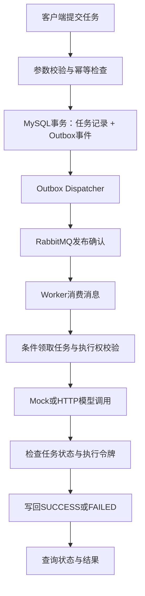

# Asynchronous AI Task Orchestration Platform

**异步 AI 任务调度与执行平台**

基于 Java 17 和 Spring Boot 的异步 AI 任务调度与模型服务平台。通过任务持久化、Transactional Outbox、RabbitMQ 消息消费和 Worker 执行权管理，将耗时的模型请求转化为可提交、可查询、可处理失败的后台任务。

## 项目介绍

同步调用大模型时，客户端需要等待模型返回结果。遇到模型响应较慢、网络异常、重复提交或服务重启等情况，业务系统还需要处理任务状态、重复执行和结果写回问题。

本项目将任务提交与模型执行分离：客户端提交请求后获得任务 ID，后台 Worker 负责调用模型并保存执行结果，客户端可以通过查询接口获取任务状态和结果。

项目重点解决以下问题：

- 同一请求重复提交时，避免重复创建任务。
- 数据库写入任务成功、消息却未成功发布时，如何恢复派发。
- RabbitMQ 重复投递时，避免多个 Worker 无条件重复执行任务。
- 超时 Worker 在任务已经结束后返回结果时，避免覆盖有效状态。
- 模型接口发生超时或返回异常内容时，如何限制请求并安全处理失败。
- 入口请求过多时，如何通过 Redis Lua 实现原子限流。

## 技术栈

| 技术 | 用途 |
|---|---|
| Java 17 | 任务服务与后台执行逻辑 |
| Spring Boot 3.5.x | HTTP API、配置与依赖管理 |
| Spring JDBC、MySQL 8 | 任务状态、幂等记录和 Outbox 持久化 |
| Spring AMQP、RabbitMQ | 任务消息派发与异步消费 |
| Redis、Lua | 可选的原子固定窗口限流 |
| Java HttpClient | OpenAI-compatible 模型 HTTP 调用 |
| JUnit Jupiter、Maven | 自动化测试与构建 |

具体依赖版本以 `pom.xml` 为准。

## 架构与执行流程



上图描述的是显式启用 MySQL、Outbox 和 RabbitMQ 的持久化执行链路。默认的 `memory/local/mock` 模式使用内存存储与有界线程池，不会自动经过 Outbox 或 RabbitMQ。

## 核心实现

### 1. 任务提交与幂等处理

HTTP 接口接收任务内容和幂等键。服务端对输入进行规范化，并通过持久化约束识别重复请求。

- 同一幂等键对应相同输入时，返回已有任务。
- 同一幂等键对应不同输入时，返回冲突。
- 新任务通过明确的状态流转进入后台执行。

幂等处理不仅依赖应用层先查询再插入，还需要数据库唯一约束处理并发提交，避免两个请求同时通过检查后创建重复任务。

### 2. Transactional Outbox

启用持久化链路后，任务记录和待派发的 Outbox 事件在同一个 MySQL 本地事务中写入。

`JdbcTaskRepository` 负责任务及相关持久化操作，`OutboxDispatcher` 负责认领待派发事件、发布消息并根据发布确认更新事件状态。

数据库事务无法同时覆盖 MySQL 和 RabbitMQ，因此 Outbox 用于避免任务已经落库、待派发事件却丢失的问题。

如果消息已经发布，但本地未能确认派发状态，事件仍可能被再次发布。系统因此采用至少一次派发，并结合后续的条件领取控制重复执行；不宣称端到端 exactly-once。

### 3. RabbitMQ 消费与 Worker 执行权

`RabbitTaskConsumer` 处理消息消费、确认及异常情况。`TaskWorker` 只有在成功领取任务后才调用模型。

Worker 通过数据库条件更新竞争任务执行权，而不是简单地根据收到的消息就开始处理。重复消息、已经结束的任务和领取失败的任务不能直接触发有效执行。

对于存储故障、无效消息和无法安全处理的异常，消费流程需要区分处理，避免失败后立即反复消费形成热循环。

### 4. 执行期限与迟到结果保护

任务执行过程中可以使用执行令牌和截止时间控制结果写回。

任务超时后，扫描逻辑负责将符合条件的任务收口；Worker 返回结果时，还需要检查任务状态、执行令牌和数据库时间等条件。

例如，Worker A 已经超时，而任务已由系统标记为失败，即使 A 随后收到模型响应，也不能仅凭旧响应将任务重新写成成功。

该机制保护的是本地任务状态和结果写回，并不代表能够取消已经发出的外部模型请求，也不等于分布式系统中的完整 fencing 机制。

### 5. Redis Lua 限流

项目提供可选的 Redis Lua 固定窗口限流，根据请求来源进行计数，并在超过限制时返回 HTTP 429。

计数与窗口处理放在同一个 Lua 脚本中，避免并发请求分别执行读取和递增时产生竞态。启用限流后，Redis 不可用时采用失败关闭策略，而不是静默取消限制。

### 6. 模型调用适配

项目默认使用确定性 Mock Provider，便于在不配置真实模型密钥的情况下运行任务流程。

切换到 OpenAI-compatible HTTP Provider 后，模型调用需要处理连接和读取超时、响应体大小、非成功状态码及非法响应等问题，并将外部错误转换为受控的任务失败信息。

模型调用失败不会自动切换到 Mock 并伪装成正常结果。模型调用与任务状态写回分离，使外部接口故障不会直接破坏任务状态机。

## HTTP API

| 接口 | 功能 | 主要响应 |
|---|---|---|
| `POST /api/tasks` | 提交任务 | 新任务返回 202；幂等复用返回 200 |
| `GET /api/tasks/{id}` | 查询状态与错误信息 | 成功返回 200；任务不存在返回 404 |
| `GET /api/tasks/{id}/result` | 查询任务结果 | 处理中返回 202；成功返回 200；失败返回 409 |

任务状态主要包括：

```text
PENDING → RUNNING → SUCCESS
                   └→ FAILED
```

终态任务不会被再次执行。排队拒绝、模型调用失败及其他受控错误会按照相应路径收口。

### 调用示例

```powershell
$body = @{
    idempotencyKey = "demo-001"
    input = "请对这段文本进行摘要"
} | ConvertTo-Json

$task = Invoke-RestMethod `
    -Method Post `
    -Uri "http://127.0.0.1:8081/api/tasks" `
    -ContentType "application/json; charset=utf-8" `
    -Body ([Text.Encoding]::UTF8.GetBytes($body))

Invoke-RestMethod "http://127.0.0.1:8081/api/tasks/$($task.taskId)"
Invoke-RestMethod "http://127.0.0.1:8081/api/tasks/$($task.taskId)/result"
```

## 本地运行

### 环境要求

- JDK 17
- Maven
- 可选：MySQL 8、RabbitMQ、Redis
- 可选：OpenAI-compatible 模型服务及 API Key

### 1. 构建项目

在仓库根目录执行：

先将当前终端的 `JAVA_HOME` 指向已安装的 JDK 17，并确认 Maven 使用同一版本：

```powershell
$env:Path="$env:JAVA_HOME\bin;$env:Path"
java -version
mvn -version
mvn -B -ntp verify
```

### 2. 启动应用

```powershell
java -jar target/ai-task-platform-0.1.0-SNAPSHOT.jar --debug=false
```

应用默认监听 `127.0.0.1:8081`。启动后，可在另一个终端执行：

```powershell
powershell -NoProfile -File scripts/smoke-test.ps1
```

默认 Mock 模式不需要真实模型 API Key，也不要求先启动 MySQL、RabbitMQ 或 Redis。

### 3. 启用真实基础设施

项目提供 `config/` 下的配置示例，以及 `scripts/` 下的 MySQL、RabbitMQ、Redis、Outbox 和 Worker 执行期限验证入口。

启用持久化模式前，需要在独立数据库中审核并执行 `database/` 下的建表与迁移脚本。应用不会自动升级已有数据库结构。

使用 HTTP 模型 Provider 时，还需要满足项目规定的持久化与执行期限配置要求。具体参数见 [演示指南](docs/demo-guide.md)。

主要运行配置由进程环境传入；不要把真实值写进配置示例或 Git：

| 用途 | 配置名称 |
|---|---|
| 存储与派发模式 | `TASK_STORAGE_MODE`、`TASK_MESSAGING_MODE`、`TASK_OUTBOX_ENABLED` |
| MySQL | `AI_TASK_DB_HOST`、`AI_TASK_DB_PORT`、`AI_TASK_DB_USERNAME`、`AI_TASK_DB_PASSWORD` |
| RabbitMQ | `RABBITMQ_HOST`、`RABBITMQ_PORT`、`RABBITMQ_USERNAME`、`RABBITMQ_PASSWORD`、`RABBITMQ_VHOST` |
| 可选 Redis 限流 | `TASK_RATE_LIMIT_ENABLED`、`REDIS_HOST`、`REDIS_PORT`、`REDIS_USERNAME`、`REDIS_PASSWORD` |
| Worker 与期限 | `TASK_WORKERS`、`TASK_QUEUE_CAPACITY`、`TASK_EXECUTION_TIMEOUT_ENABLED`、`TASK_EXECUTION_TIMEOUT_MS` |
| 可选模型 HTTP | `MODEL_MODE`、`MODEL_BASE_URL`、`MODEL_API_KEY`、`MODEL_NAME`、`MODEL_REQUEST_TIMEOUT_MS` |

变量默认值和约束以 [application.yml](src/main/resources/application.yml) 及对应 Configuration 类为准。MySQL 数据库名固定；Outbox、Rabbit、HTTP 模型不是仅提供一个密码就会自动启用。

## 测试与验证

项目包含任务 API、状态机、幂等、持久化、消息派发、重复消费、执行期限、限流和模型 HTTP 协议等测试。

默认回归以本地测试环境和 Mock 为主；真实 MySQL、RabbitMQ、Redis 验证通过独立脚本显式执行。不同测试覆盖的运行环境不同，不能把离线测试结果直接解释为生产容量或端到端 exactly-once 保证。

本目录为独立发布候选快照，不携带原开发 Git 历史、运行日志或数据库记录。历史阶段报告用于说明已执行范围，当前快照的验收与许可状态见 [发布审查](docs/PUBLICATION_REVIEW.md)。

- [演示与部署](docs/demo-guide.md)
- [持久化设计](docs/persistence-design.md)
- [RabbitMQ 消息设计](docs/rabbitmq-design.md)
- [执行期限与 Worker 租约](docs/phase4b-verification.md)
- [HTTP 模型适配](docs/phase4c-verification.md)


## 许可证

本项目由权利人有权授权的自有源码采用 **Apache License 2.0**（SPDX：`Apache-2.0`），完整条款见 [LICENSE](LICENSE)。

第三方依赖及其法律文本仍适用各自许可证，不因本项目授权而变更。详见 [THIRD_PARTY_NOTICES.md](THIRD_PARTY_NOTICES.md) 和 [依赖许可证审查](docs/DEPENDENCY_LICENSE_REVIEW.md)。

