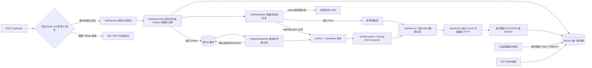

# 项目集中学习与面试复盘

更新日期：2026-10-14。Phase5开发基线 **adfc5da**；真正使用Microsoft JDK17.0.16构建/运行，**147本地测试＋独立生产Scheduled/MySQL/Rabbit/Mock业务闭环＋既有1项真实所有权回归通过**。24正常/1业务失败、25SENT，历史元数据未变。Phase4C本地模型HTTP证据保留，第三方调用0次。按本轮授权本地提交、不push，核心MVP收尾后停止，进入简历审核/集中复盘。长期规则见 AGENTS.md。

## 1. 当前架构与业务链路

同步路径完成限流/校验和任务注册；local 排队、direct rabbit 等待发布确认，outbox 则同事务记录派发意图后直接受理，由后台发布。TaskWorker 认领后才调用模型，终态字段同一 SQL 写入；Phase 4B 可选内部 token/期限校验，定期将新过期任务 FAILED，不重跑。rabbit 必须 MySQL，outbox 必须 mysql/rabbit，默认 memory/local 无外部服务。期限保护与 Outbox 均有真实 MySQL 核心证据；Phase 4C 验证完整任务链路中的实际模型 HTTP，但服务为本地模拟，不是第三方 LLM。没有认领/完成 HTTP 接口，REST 不公开内部执行元数据。

状态机：PENDING → RUNNING → SUCCESS/FAILED；本地排队拒绝允许 PENDING → FAILED，Rabbit 发布失败保留 PENDING；终态不可迁移。同键 PENDING 的 Rabbit 重派不重建行，执行仍由数据库仲裁，不能恢复 RUNNING。

## 2. 技术选型及其目的

| 组件 | 当前用途 | 需要解释的取舍 |
| --- | --- | --- |
| Java17、Spring Boot3.5.16 | 单体REST/配置；最终真实Microsoft JDK17构建、测试及独立JAR启动 | release17与运行证据分开；历史JDK25测试也保留 |
| Spring JDBC / JdbcTemplate | 明确表达 INSERT、状态条件 UPDATE、受影响行数 | SQL 和事务语义直观，当前无需 ORM 复杂度 |
| MySQL 8.0.45 / InnoDB | 独立 ai_task_platform，持久化与数据库唯一键仲裁 | JVM synchronized 无法保护跨实例，数据库约束可以 |
| HikariCP | 生产应用连接池，mysql 模式显式装配 | 启动成功不保证已访问数据库；连接错误返回 503 |
| 有界 ThreadPoolExecutor | 当前异步执行入口，2 workers / 64 queue 默认配置 | 有界防止无限堆积，但进程内队列不持久化 |
| Spring AMQP 3.2.12 / Rabbit client 5.25.0 | 可切换消息派发、confirm/mandatory、manual ACK、parking | Boot BOM 管理版本，实际 RabbitMQ 4.3.6 链路通过；队列持久化不等于 MySQL/MQ 事务 |
| Spring Data Redis 3.5.13 / Lettuce 6.6.0.RELEASE | 默认关闭的提交来源 IP 限流，Lua 原子计数与 TTL | 跨 JVM 共享额度，Redis 故障 fail-closed；不代替 DB 幂等或增加缓存 |
| MySQL Transactional Outbox / Spring Scheduled | 显式事件同事务落库、短事务认领、confirm 后标记、到期重派与有限退避 | 人工迁移后真实核心验收通过；至少一次派发、隔离待处理，不是 MQ/DB 分布式事务 |
| ModelClient + MockModelClient | 模型调用与编排分离，可确定性模拟成功/失败 | 是模型适配边界，当前没有真实 LLM 调用或 AI 效果验证 |
| JUnit / Surefire / Failsafe | 默认离线质量门槛、显式真实 MySQL 验收 | 离线契约与真实驱动/数据库证据分开；无 Mockito/H2 |

RabbitMQ 核心链路及最小双实例消费已真实验收；MQ 崩溃/磁盘故障、跨 JVM 重启部署和 HA 未验收。Redis 仅用于已真实跨 JVM 验证的提交限流；XXL-JOB 尚未引入。

## 3. 幂等与并发的关键原理

### 注册幂等

请求键带唯一索引，先 INSERT，不采用“先 SELECT 再 INSERT”。同键插入冲突由 MySQL 仲裁；仅 DuplicateKeyException 进入恢复分支。失败写事务退出后，独立只读事务查同键胜出行，Java 比较规范化输入：相同返回原 UUID，不同返回 409。找不到同键行时保留 SQL 错误，避免主键碰撞被当作幂等成功。

规范化采用 NFC 与 CRLF/CR → LF，保留大小写和空格；normalization_version=NFC_LF_V1。ASCII 幂等键大小写敏感。不要用数据库输入列的忽略大小写/重音排序规则决定输入是否等价。

### 状态条件更新

认领 SQL 的条件为 `task_id=? AND status='PENDING'`；完成条件为 RUNNING。一次更新恰好影响一行才成功，零行抛明确状态冲突。两个真实连接竞争时，InnoDB 串行仲裁同一行的更新条件，失败方不能覆盖胜出状态。

`version` 每次状态变更递增：PENDING=0、RUNNING=1、正常终态=2。它目前是变更计数，**没有参与 WHERE 条件，也不是 Worker 所有权或 fencing token**。不能把它描述为完整乐观锁/租约方案。

### 事务边界与失败

Repository 为 REQUIRES_NEW / READ_COMMITTED 短事务；认领提交后才调用模型，模型执行不长期持有数据库事务。模型成功但 SUCCESS 落库失败时，不把它改写成 MODEL_CALL_FAILED，因为提交可能已生效但响应丢失。存储/事务故障与模型故障分开记录，SQL 内容和敏感输入不进入业务错误响应。

排队拒绝只尝试 PENDING → FAILED，不能覆盖已经认领的 RUNNING。认领竞争失败的执行者退出，不调用模型。

## 4. 核心源码与推荐阅读顺序

路径均相对仓库根目录，Java 包前缀为 `src/main/java/com/example/aitask/`。

| 阅读顺序 | 源码 | 重点 |
| --- | --- | --- |
| 1 | api/TaskController.java | POST 创建/复用、GET 状态/结果、202/200/409/503 语义 |
| 2 | service/TaskService.java、service/TaskWorker.java | submit 注册/派发；worker.execute 认领/模型/终态，区分存储阶段 |
| 3 | domain/TaskStatus.java、domain/TextTask.java | 状态机、不变快照、输出/错误码校验 |
| 4 | service/TaskInputRules.java | 输入规范化、键/Unicode 校验 |
| 5 | repository/TaskRepository.java、repository/JdbcTaskRepository.java | INSERT 优先、唯一键恢复、条件 UPDATE、事务边界 |
| 6 | config/StorageConfiguration.java | 固定业务库、外部环境、显式 mysql 模式、连接池与异常翻译 |
| 7 | config/ExecutionConfiguration.java、model/ModelClient.java | 有界执行资源、模型接口 |
| 8 | api/ApiExceptionHandler.java | 参数/幂等/状态/存储错误 HTTP 映射 |
| 9 | database/001_init.sql | 唯一键、索引、生命周期 CHECK、UTC DATETIME(6)；只供人工初始化 |
| 10 | src/test/java/com/example/aitask/repository/JdbcTaskRepositoryMySqlIT.java | 独立真实连接、屏障竞争、两边回读完整快照/version |
| 11 | scripts/verify-mysql.ps1 | 安全密码输入、一条完整 verify、真实 XML 汇总、证据归档 |
| 12 | service/TaskDispatcher.java、messaging/ConfirmedRabbitPublisher.java | 本地与 Rabbit 派发切换、PENDING 重派、确认/返回处理 |
| 13 | messaging/RabbitTaskConsumer.java、config/MessagingConfiguration.java | ACK、有限退避、隔离、暂停和条件装配 |
| 14 | src/test/java/com/example/aitask/repository/TaskPipelineRabbitIT.java、scripts/verify-rabbit.ps1 | 真实 HTTP/DB/MQ、两个独立应用上下文的交叉派发/竞争，原始 XML/日志归档 |

## 5. 面试高频问题与回答要点

1. **为什么不直接给方法加 synchronized？** 它只能保护一个 JVM。业务可有多个实例，唯一键和条件 UPDATE 的仲裁应在共享数据库中完成。
2. **幂等键相同但请求内容不同怎么办？** 冲突，不能复用。先按版本规则规范化，然后精确比较输入，HTTP 409。
3. **两个 Worker 会不会都执行模型？** 当前 PENDING 的条件认领只允许一个成功，失败方退出。真实双连接测试验证这一状态仲裁；不能据此宣称所有崩溃/恢复路径都 exactly-once。
4. **为什么版本加一不等于完整乐观锁？** WHERE 没有检查版本，当前靠状态仲裁；将来重新执行同一任务需 attempt/所有权等独立设计，避免旧 Worker 写新执行结果。
5. **事务为什么不包住模型请求？** 外部调用可能很慢，会延长锁与连接占用。分为认领、模型、完成三个阶段，以数据库状态暴露故障窗口。
6. **模型成功但数据库连接断了怎么办？** 提交结果可能未知，日志不能代表数据库最终状态；查询后再判断，不能自动改成模型失败或盲目重跑。
7. **线程池满了、应用重启了怎么办？** 满时新任务标记 EXECUTION_REJECTED；内存队列在重启后丢失，可能留下 PENDING/RUNNING。目前没有恢复，Phase 3/4 分别解决可靠派发和补偿。
8. **RabbitMQ 如何保证不丢任务？** 直接双写有窗口；显式 Outbox 为新任务同事务记录意图，再确认发布与到期重派。Phase 4A 已真实验证事务回滚、CAS 单胜、confirm 后未标记的重复投递和模型幂等；有限重试耗尽要隔离处理。不存在端到端 exactly-once，Broker 崩溃耐久性未验证。
9. **重复消息怎么处理？** 复用数据库条件认领；终态重复 ACK，RUNNING 无所有权信息时隔离；模型业务异常写 FAILED，认领存储失败有限退避，完成存储失败不重跑模型，不能无限 requeue。
10. **Redis 解决了什么问题？** 多实例共享提交额度，使用单个 Lua 原子计数与 TTL；MySQL 继续负责注册幂等/状态一致性。Redis 不可用明确返回 503，不用本地计数冒充分布式限流，不用 Redis 锁代替数据库约束。
11. **你怎么证明并发正确？** 提供两个不同 MySQL CONNECTION_ID、同步竞争、单胜出/单冲突、最终行字段/版本、原始 XML 和 Maven 退出码，离线替身不作为真实证据。
12. **项目最大的局限？** 固定 RUNNING 所有权/超时已有代码及离线证据，真实验证等 003；没有续期/重跑、外部单调 fencing、完整恢复/重放、认证/租户、真实模型和生产级故障/性能证据。不虚构能力。

## 6. 已验证证据与简历表达

2026-10-13 11:18:21 +08:00，自动执行一键验收：Maven verify 退出码 0；99 项离线（保留原 87 项）和 22 项真实 MySQL 测试全部通过。MySQL 8.0.45，两个服务端连接 ID 为 25/26。认领成功/冲突 5/5，终态完成成功/冲突 5/5，同键不同输入插入成功/冲突 5/5，同键等价输入创建/复用 5/5。终态竞争实际产生 3 次 SUCCESS、2 次 FAILED；两种终态禁止覆盖均验证。

留存 22 行本轮测试数据：10 PENDING/version=0、5 RUNNING/version=1、4 SUCCESS/version=2、3 FAILED/version=2。数据库状态由测试的两连接回读得到，不由日志字符串猜测代替断言；没有删除数据。完整报告及样例 UUID/时间见 docs/phase2b-verification.md，原始证据在 target/phase2b-runs/，默认不进 Git。

现阶段可使用的简历表述：

> 基于 Spring Boot 与 MySQL 构建异步文本任务服务，使用唯一幂等键与状态条件更新实现跨实例任务注册、原子认领和终态保护；以独立真实 JDBC 连接并发验收单次认领及结果一致性，支持持久化查询和明确的业务/存储错误处理。

这是后端工程亮点，不代表调用过真实第三方模型。Rabbit/Redis/Outbox/Worker与HTTP适配可使用各节已验证表述；Phase5小样本延迟见第14节，不能推广为QPS/容量。XXL-JOB未实现，不写入简历能力。

## 7. 阶段推进与学习安排

- Phase 2B：核心真实并发验收已通过，可进入 Phase 3；不额外建设大规模测试平台。
- Phase 3A/3B：真实验收证据保留，2026-10-14 合并为本地 f4ba045；安全审核 37 个提交文件，未 push。
- Phase 4A：人工迁移后130本地＋1真实联合测试通过，提交43c9b49，不push。
- Phase 4B：固定执行期限/所有权与保守FAILED，人工003和138本地＋1真实MySQL通过，提交ff3eb42；不重跑，不把随机token描述为外部fencing。
- Phase 4C：已完成最小OpenAI-compatible HTTP适配，146本地＋1真实基础设施/模拟模型HTTP链路通过；实际未接入XXL-JOB或收费模型。
- Phase 5：147本地、独立JDK17生产定时链路及真实expiry回归通过；有限性能/故障证据、部署/演示/简历/复盘资料已整理。授权本地提交后停止开发，进入投递和学习。

最终集中复盘按“API/限流 → 编排 → 状态机 → JDBC/事务 → MQ → 恢复 → 测试证据”顺序；每个阶段结束补充本文件，用户无需逐功能手动验收。

## 8. Phase 3A 核心方法与 Java 后端面试映射

| 核心类 / 方法 | 当前实现原理 | 对应面试问题 |
| --- | --- | --- |
| TaskService.submit | MySQL 注册事务完成后由 dispatcher 决定派发，保持 API/唯一键契约 | 同步受理和异步执行如何分层？为什么创建任务不包住模型事务？ |
| TaskDispatcher.shouldDispatch、ConfirmedRabbitPublisher.shouldDispatch | local 仅首次，rabbit 允许同键 PENDING 再发；终态不派发 | 请求幂等与消息重复有什么区别？为什么允许重复发送却不允许重复认领？ |
| ConfirmedRabbitPublisher.publish | 等待 CorrelationData future，并检查 confirm ACK 与 getReturned | confirm、mandatory、consumer ACK 分别解决什么？ACK 但无路由为何仍要失败？ |
| TaskMessages.task / id | 只传 canonical UUID + schema v1，输入从数据库读，不做 Java 反序列化 | 消息体设计为何避免传数据库状态/完整输入？如何处理坏消息和协议版本？ |
| TaskWorker.execute / finish / observedOutcome | 共用条件认领和模型/终态流程；CLAIM 与 COMPLETION 存储异常分开 | 外部调用成功但落库失败为什么不能自动重跑？状态更新计数为何不是 fencing？ |
| RabbitTaskConsumer.receive | 有限认领重试，固定退避；终态重复 ACK，RUNNING 隔离 | 消费幂等在哪一层保证？重试为何需要上限，认领失败与完成失败为何不同？ |
| RabbitTaskConsumer.isolate / acknowledge | 先确认隔离副本再 ACK 原消息；失败保留 unacked 并暂停 | ACK 时机怎么选？copy→ACK 有什么重复窗口？怎样避免无限立即 requeue？ |
| MessagingConfiguration.taskConsumerPause | 独立线程停止整个 listener，prefetch=1；应用重启后恢复 | 为什么不在 listener 线程同步 stop？消费者暂停的运维与恢复边界是什么？ |
| TaskQueueNames.declarations | 两 durable 队列、专用 vhost/前缀；无 TTL/DLX 重试环 | durable 队列、persistent 消息分别是什么？为什么普通 DLX 也有丢失风险？ |
| MessagingConfiguration.validateMessagingMode | rabbit 必须 MySQL，default local 无 broker factory，不默默降级 | 如何做显式基础设施开关和启动配置校验？为什么测试环境不应自动连服务？ |

可靠性回答要落到具体窗口：本阶段是“数据库任务持久化 + 确认发布 + 同键 PENDING 重派”，没有事务 outbox。无人重试时仍可能滞留 PENDING；RUNNING 崩溃不能自行改回 PENDING。Phase 4 再设计持久派发、补偿、所有权/租约和幂等隔离重放，涉及 schema 时另行审核迁移。

初版证据：2026-10-13 11:52:47 +08:00，113 离线＋22 真实 MySQL 回归通过。恢复环境后 **13:15:06** 的完整 verify 为 **113 离线＋1 真实 MQ 综合链路**通过，**13:17:36** 的 **22 真实 MySQL 定向回归**也通过。FakeTemplate/ACK recorder 仍只算离线证据；真实 TaskPipelineRabbitIT 使用实际 HTTP、JDBC、broker 和生产 listener，没有拿这些替身代替 MQ。报告见 docs/phase3a-verification.md。

简历现阶段可以说明“基于 RabbitMQ 实现异步任务派发与消费，使用发布确认、mandatory 返回检查、手动 ACK 和数据库条件认领处理重复消息及失败隔离，并以真实 HTTP/MySQL/RabbitMQ 验证核心链路和两个独立应用实例竞争”。补充说明实例在同一 JVM；不能写 MQ 重启无丢失、完整恢复、端到端 exactly-once 或虚构吞吐。

## 9. 真实双实例验收的讲解要点

- `TaskPipelineRabbitIT.startInstance` 创建 A/B 独立 Spring Boot 上下文，HTTP 60909/56926、独立 DataSource/Rabbit factory/registry；真实 MySQL session=32/34。它不是启动两个线程冒充实例，但也不是两个独立 JVM。
- `observe` 包装真实 ChannelAwareMessageListener，仅记录投递，不替换 broker/Repository/生产执行；A/B 完成消费 12/5，模型调用 4/1，总计 17/5。
- 交叉场景暂时停止测试实例 A 的消费，让 A HTTP 请求由 B 处理，再反向验证，明确派发不依赖本地线程池。仅停止本次测试 listener，不动 P2 或 Docker broker。
- `CountingModelConfiguration.countedMockModel` 仍委托实际 MockModelClient.process；CountDownLatch 只把竞争任务停留在 RUNNING（数据库认领已提交），方便确定性验证 8 条同 UUID 消息 A/B 各收到 4 条、仅一次模型执行、7 次状态冲突隔离。生产 ModelClient 没有加这个测试门禁。
- 竞争中直接查 version=1，释放门禁后查 SUCCESS/version=2；全部 5 行任务在两 Repository 中读到相同快照，4 SUCCESS/1 FAILED。TextTask 不含 version 字段，所以验证用直接 SELECT，不改变 REST API。
- 测试关闭两个应用后，真实 broker 工作队列 ready=0/unacked=0；隔离队列 durable=true/ready=9/unacked=0，证明原投递已确认且隔离副本保留。没有清理消息、数据或卷。

面试可以被追问：**“为什么共享 JVM 的验证仍有价值，有哪些不能证明？”** 因为 MySQL 连接/事务、Rabbit 连接/消费者和 HTTP server 都独立且真实，仲裁由数据库完成，没有业务 JVM 锁；能够证明核心消费实例间交互。它不能代替进程崩溃、不同主机网络或跨 JVM 重启部署测试，这些留给故障/部署阶段。

当前可复核资源：ai-task-platform-rabbitmq（RabbitMQ 4.3.6）、p1-ai-task_default 网络、/ai-task-platform vhost、独立卷；P2 三容器和两卷保留。消息/任务和隔离数据都用随机 run UUID，证据归档到 target，密码不写入学习资料或 Git。

## 10. Phase 3B：Redis 限流原理、源码与面试

选择 Redis 的业务原因是多实例共同限制任务提交量。JVM 本地计数在扩容后会按实例倍增额度；单个 Redis Lua 对来源键执行 GET/SET PX/INCR/PTTL，脚本期间没有其他请求插入计数与到期设置之间。默认关闭，启用后在 TaskService 前拒绝超限或存储异常，MySQL 注册幂等与 Rabbit 消费不改动。不是 Redis 分布式锁，也不增加任务缓存。

| 核心源码 / 方法 | 实现原理 | 面试问题 |
| --- | --- | --- |
| config/SubmissionRateLimitConfiguration.submissionRedisConnectionFactory | 显式开关、外部密码、Lettuce 连接/命令超时、要求 NONE 转发策略 | 默认构建如何不依赖 Redis？为何连接/命令超时都要配置？ |
| ratelimit/SubmissionRateLimitInterceptor.preHandle | 仅任务提交 HandlerMethod，先查额度后注册；只取 getRemoteAddr | 过滤器/拦截器的区别？如何保证 429 前不创建任务？ |
| ratelimit/RedisSubmissionRateLimiter.acquire / keyFor | 单脚本原子操作、共享 namespace、IP 摘要、响应/连接错误 fail-closed | 为什么 INCR 后单独 EXPIRE 有窗口？Lua 是否是回滚事务？脚本失败能否假装放行？ |
| src/main/resources/redis/submission-window.lua | 首请求启动固定窗口，拒绝不延长 TTL 或增加计数 | 固定窗口与滑动窗口/令牌桶如何取舍？边界突发问题是什么？ |
| api/ApiExceptionHandler.rateLimitError | 429+稳定业务码/Retry-After，故障 503，不泄露连接详情 | fail-open/fail-closed 的可用性与保护目标如何权衡？ |
| src/test/java/com/example/aitask/ratelimit/SubmissionRateLimitRedisIT | 两 OS 子 JVM、真实 HTTP/Lettuce/Redis、共同计数和第三故障进程 | 如何证明跨 JVM？为何 memory 任务存储不影响 Redis 限流证据、却不能证明共享 MySQL/MQ？ |
| scripts/verify-redis.ps1、infra/redis-compose.yml | 独立资源归属、凭据环境、一次完整 verify、只回收自建 JVM | 如何保护其他项目数据、避免旧报告冒充本次通过及密码入日志？ |

Lua 保证执行时的隔离，运行中某条命令报错并不自动回滚之前已写的数据。当前脚本先校验现有计数/TTL，再递增；缺少 TTL/类型错误明确失败，不修补未知键。受理超时也可能已经消耗额度，重试再次消耗属于限流保守性，不应宣称每个失败 HTTP 都不增加计数。幂等重试也计数，用于控制入口负载；业务幂等仍由 DB 保证。

来源是 TCP peer，不是登录用户。伪造 X-Forwarded-For/Forwarded/X-Client-Id 不能换额度；反向代理/NAT 后多用户共享 IP，会误伤。当前禁止自动转发头解释，未来若要按真实用户限流，需要认证，以及可信代理的网络隔离/头重写/明确允许名单，不能直接读取客户端自报头。IP 摘要避免 Redis 键明文保存地址，不代表匿名化（IP 可枚举）。

真实证据：2026-10-14 10:32:15 +08:00，119 离线＋1 真实综合测试通过；Redis 7.4.11，独立 PID=48080/48368，HTTP=62428/62429，12 次提交中 4 受理/8 限流，counter=4、TTL=59654ms。不同伪造头不绕过，GET 正常，短 TTL 自然复位；第三 PID=48904 连接未监听端口返回 503。只停止本次进程，Redis/P1 Rabbit/P2 数据卷保留。报告与本地原始路径见 docs/phase3b-verification.md。

可用于简历的已验证表述：

> 基于 Redis Lua 实现可配置的任务提交分布式限流，原子维护计数与 TTL，统一返回 429/Retry-After，并在存储故障时明确拒绝提交；使用两个独立 Spring Boot JVM 和真实 Redis 验证共享额度、来源头防伪及失败路径。

不声称用户级限流、精确滑动窗口、Redis HA 或性能指标；未验证 Broker 故障/Redis 重启丢失/远程部署。MySQL→MQ 双写缺口、任务恢复、租约和 fencing 仍留给 Phase 4。Git 基线 a2dff33，Phase 3A/3B 改动尚未提交，按最新授权本轮不 commit/push。

以上第 10 节保留 Phase 3B 当时的结论；现已提交 f4ba045。Phase 4A Outbox 新增实现与证据范围如下，不能把未验收代码计入真实能力。

## 11. Phase 4A：Transactional Outbox

核心不变量：显式 outbox 模式中，新的任务行和 TASK_SUBMITTED 事件必须一起提交或一起回滚。JdbcTaskRepository 的原 write TransactionTemplate 内用相同 JdbcTemplate 依次 INSERT 两表，再读任务返回；没有额外 REQUIRES_NEW 事件事务，也不依赖 AFTER_COMMIT 内存回调。只把任务 INSERT 的 DuplicateKeyException 当请求幂等冲突；事件写入失败（包括事件唯一键错误）直接回滚、返回存储失败，不冒充复用成功。

HTTP 返回 202 后，派发意图已经提交，Rabbit 不可用不影响本地受理；Dispatcher 后续处理。claim 的 SELECT/UPDATE 在 READ_COMMITTED 短事务中，WHERE event_id/version/到期条件执行 CAS：两个 Dispatcher 读同一版本，只有一个认领成功，失败方本轮结束等下一次固定延迟扫描。认领设置新 token、locked_until、attempts/version+1。MQ 网络等待不持有数据库事务。

confirm+mandatory 成功后，WHERE event/status/token/未到期条件标记 SENT；过期或旧令牌不能覆盖新认领。发布失败/超时/结果未知返回 RETRY，数据库时钟计算 next_attempt_at，指数退避封顶；认领过期可重派，最终尝试崩溃也会隔离，避免永远停在 DISPATCHING。8 次默认预算消耗的是派发认领次数，不是模型次数；耗尽 ISOLATED，任务可能仍 PENDING，不能当成功。

| 源码 / 关键方法 | 原理 | Java 后端面试问题 |
| --- | --- | --- |
| repository/JdbcTaskRepository.createOrGet | task+event 同一事务，任务/事件唯一键异常分类 | 为什么外层 @Transactional 包不住内部 REQUIRES_NEW？为何 AFTER_COMMIT 不能替代 Outbox？ |
| outbox/JdbcOutboxRepository.claim | DB UTC 时间、版本 CAS、短事务、可选单任务范围 | CAS 与 SELECT FOR UPDATE 的取舍？两个实例为何只有一个有效认领？如何避免网络 I/O 长时间持锁？ |
| outbox/JdbcOutboxRepository.markSent / markFailure | 有效 token/未到期条件更新；失败退避/隔离 | confirm 后数据库更新失败怎么办？为何不能直接把发送视为失败或宣称 exactly-once？ |
| outbox/OutboxDispatcher.dispatchBatch | 有界批次，confirm 与 SENT 分开计数，存储/意外错误明确分类 | 发布、消费 ACK、业务成功和模型成功分别证明什么？ |
| outbox/OutboxSettings.backoffMillis、OutboxPoller.poll | 有界指数退避、固定延迟扫描、最终尝试到期隔离 | 无限立即重试有哪些问题？有限预算为什么仍需补偿/运维？ |
| config/OutboxConfiguration | mysql/rabbit 门禁、表结构只读验证、Primary 提交策略 | 如何避免同时 HTTP 直接发布和 Outbox 双派发？缺表时如何拒绝不可靠降级？ |
| outbox/OutboxSubmissionDispatcher.shouldDispatch | 已落库意图，HTTP 不再 MQ 双写 | 202 的保证是什么？Broker 不可用时为什么能受理？ |
| database/002_outbox.sql | 独立表、FK/事件唯一键/状态索引/CHECK | 新表迁移如何做到非破坏性？业务账号为何不能执行 DDL？ |
| TaskOutboxTransactionTest / OutboxDispatcherTest | 重用离线事务 fixture、调度故障和并发控制契约 | 离线 Java 锁测试能证明真实 MySQL 行锁吗？不能，真实证据如何补？ |
| TaskPipelineOutboxIT / scripts/verify-outbox.ps1 | 显式审批、真实三会话/生产 ACK、唯一任务范围、无清理 | 如何保证真实验收不扫到旧业务 Outbox 事件？如何保护凭据？ |

至少一次窗口：消息已被 Broker 接收但 confirm 丢失，或 confirm 成功而 SENT 落库失败/进程崩溃，都会可能重复发布。messageId 固定为 eventId 便于追踪，不自动实现 Rabbit 去重；taskId 仍是消费者的最终数据库认领键。SENT≠已消费≠SUCCESS≠真实模型质量；当前 Mock，无付费调用。Outbox 认领的 token/到期机制仅保护事件状态，不是 RUNNING Worker 的租约/fencing，后者留给 Phase 4B。

证据：11:15:32 +08:00 完整 Maven verify 130 项通过（119 原有＋11 核心新增）；旧默认 memory/MQ/Redis 关闭装配、配置异常及 API 契约保留。新增配置测试起初被组件扫描污染其他上下文，造成 7 个失败，已改仅显式注册并重跑全套通过。早期编译的变量命名冲突也已修复。没有将这些失败或负向门禁算通过。

初版迁移未批准时，脚本退出 2、直接 outbox-it Maven 退出 1，均在连接/凭据提示前拒绝。用户现已人工迁移，本次设置测试进程 schema flag 后首次联合测试通过，未改生产代码或扩大规模。详情与原始日志路径见 docs/phase4a-verification.md。

能力边界：不自动回填旧 PENDING，不自动重放 ISOLATED/parking，不恢复 RUNNING，不恢复已暂停消费者；未验证 Broker 崩溃/跨 JVM 派发/高负载。任务与事件都持久化不意味着有限预算内一定执行成功；DB 长期不可用或派发隔离仍需要补偿。默认 Outbox 关闭时旧 direct rabbit 仍有双写窗口，应明确选择部署模式。

新增真实证据：2026-10-14 11:41:41 +08:00，130 离线＋1 真实 Outbox 全通过。业务用户只有 P1 库 SELECT/INSERT/UPDATE，四个 CHECK 与 FK 生效。Dispatcher 会话 11/12 先同时真实 SELECT 相同候选再 CAS，仅一个认领；Worker 会话 13。确认后受控 pre-update 故障保持 DISPATCHING，自然约 30 秒到期重派；3 个实际投递只执行 2 次 Mock，旧 token 被拒绝。真实 mandatory return 两次后 ISOLATED，真实 FK 错误回滚任务。测试同 JVM，未模拟进程崩溃/数据库断网，不夸大注入范围。

回查最终行：race 任务 SUCCESS/v2，事件 SENT/attempt1/v2；replay 任务 SUCCESS/v2，事件 SENT/attempt2/v3；无路由任务 PENDING/v0，事件 ISOLATED/attempt2/v4/PUBLISH_UNCONFIRMED。重派任务 completed_at 在首次消费时已设置，而 SENT 延迟约 30 秒，能解释消息状态与业务状态分离。手动 ACK 后本轮两个 durable 队列 ready/unacked/consumer=0；保留 3 个任务/3 个事件，没有旧数据修改或清理。

当前可用于简历的已验证表述：

> 基于 MySQL Transactional Outbox 持久化任务派发意图，通过版本 CAS、认领令牌、Publisher Confirm 和有限退避实现至少一次派发；使用独立真实 JDBC 会话与 RabbitMQ 验证并发单胜、事务回滚、确认后重派及消费者幂等保护。

可以深入讲解事务边界和故障窗口；不能写端到端 exactly-once、Broker 故障耐久性、跨 JVM Outbox 崩溃恢复或虚构性能。用户无需再执行数据库迁移；Phase 4A 本地提交后停止等待审核，后续 4B 再做 RUNNING 租约/fencing。

原理参考：[Spring JDBC 本地事务连接绑定](https://docs.spring.io/spring-framework/reference/data-access/jdbc/connections.html)、[Rabbit confirm 与 mandatory return](https://docs.spring.io/spring-amqp/reference/amqp/template.html)、[MySQL 并发读写与锁](https://dev.mysql.com/doc/refman/8.0/en/innodb-locking-reads.html)。当前选择版本 CAS，未实现 SKIP LOCKED 框架或新的分布式锁。

参考：[Spring Data Redis scripting](https://docs.spring.io/spring-data/redis/reference/redis/scripting.html)、[Redis Lua 原子性与限制](https://redis.io/docs/latest/develop/programmability/eval-intro/)、[Spring Boot 转发头配置](https://docs.spring.io/spring-boot/3.5/how-to/webserver.html#howto.webserver.use-behind-a-proxy-server)。源码和实际验收是本项目实现证据，官方文档用于复盘原理。

## 12. Phase 4B：固定执行所有权与保守超时

这是固定期限，不是 heartbeat/自动重跑系统。启用时 PENDING→RUNNING 同时写 UUID token 和 DB UTC 截止时间。TaskWorker 持有内部 Execution 句柄，成功/模型失败都要求状态 RUNNING、token 匹配、数据库时间未过期；原 TextTask/REST DTO 不加内部字段。完成/超时清空元数据，终态不能迁移；因此没有将 TASK_TIMEOUT 自动转回 PENDING，也不会重复调用模型。

TaskTimeoutChecker 沿用Spring @Scheduled，有限批次将过期RUNNING变为FAILED/TASK_TIMEOUT，设置completed_at、output=NULL、version+1。Phase5因真实死锁将扫描UPDATE改为无锁读候选、逐个按主键条件UPDATE；双处理者仍重新检查状态/期限、只有一次成功。必须有非NULL token，旧无法确定所有权的记录不处理。

| 核心源码 / 方法 | 实现原理 | 面试问题 |
| --- | --- | --- |
| TaskRepository.Execution / claimExecution / succeedExecution / failExecution | 内部句柄携带 token/deadline，关闭功能时显式走旧契约 | 为什么不把执行令牌放进 REST？为什么不能让普通 succeed(id) 绕过保护？ |
| JdbcTaskRepository.claimExecution / lockTask | 短事务先 InnoDB 行锁，再新语句 DB 时间写入 token/deadline | MySQL NOW/UTC_TIMESTAMP 的语句时间与锁等待有什么关系？为何模型不能占用事务？ |
| JdbcTaskRepository.completeExecution | WHERE taskId/RUNNING/token/deadline 同时成立，终态清空元数据 | 旧 Worker、错误 token、到期前开始但等待锁的完成如何拒绝？ |
| JdbcTaskRepository.expireRunning | 有限批次条件 UPDATE，数据库时钟、version+1，仅带 token 的新任务 | 两个超时处理者如何只成功一次？为何不用 Redis 锁或重新调用模型？ |
| InMemoryTaskRepository 受保护方法 | 同语义的同步 Map/Clock，默认模式兼容 | 单 JVM 模拟能否证明 MySQL 锁或跨实例？不能，应该怎样补真实证据？ |
| TaskWorker.execute / finish | 完成携带句柄，冲突观察当前状态，晚到结果/错误不写回 | TASK_TIMEOUT 与 MODEL_CALL_FAILED/存储失败如何区分？如何保证不重跑模型？ |
| TaskTimeoutChecker.check / poll、TaskTimeoutConfiguration | 复用已有 scheduler，错误分类、开关/范围/结构门禁 | 定期扫描是否有精确实时保证？调度线程被 Outbox 占用时会怎样？ |
| database/003_worker_lease.sql | 两可空字段、索引、独立 CHECK，原生命周期约束保留 | 老 RUNNING 如何迁移？为什么不凭空 backfill token/截止时间？ |
| TaskExecutionTimeoutTest、TaskTimeoutConfigurationTest | 8 项关键离线契约，Clock 只用于 memory 单测 | 为什么过期完成在扫描前也必须拒绝？旧失败不能被晚到模型成功改写意味着什么？ |
| TaskExecutionLeaseIT、scripts/verify-worker-lease.ps1 | 已通过；写入前只读核对 003/最小权限，两个独立真实连接、限定随机 taskId、无清理 | 如何证明数据库终态 version=2、并发单胜和旧者不能覆盖？ |

MySQL 当前时间函数按语句求值；因此新认领/完成先用 SELECT FOR UPDATE 取得本地行锁，再执行带 UTC 时间的 UPDATE，避免长锁等待使用过时的语句时间。有效性是数据库校验时的语义，不保证硬实时提交或外部调用取消。短事务结束后才调用 Mock，未添加分布式锁/调度框架。

默认 timeout-enabled=false，保留未迁移 MySQL 和原 memory/local；关闭时没有新期限保护。开启缺字段/错误配置拒绝启动，无静默回退。新约束允许旧 NULL/NULL，原字段不回填；扫描忽略旧 RUNNING。上线必须停/排空旧 Worker并统一启用，不能混用开关；手工处理遗留记录另行审核。

新增 UUID token 是数据库当前执行者匹配条件，**不是传给外部系统的单调 fencing 序列**。没有续期/重跑/取消模型请求，超时模型可能仍在执行但结果被丢弃；不保证费用撤销或外部副作用 exactly-once。超时扫描可能延迟，但写入期限守卫独立有效；过期完成在扫描前仍 Running 时沿用 Rabbit 的 IN_PROGRESS/隔离路径，不新增重放平台。

当前证据：2026-10-14 15:33:09 +08:00，完整 verify 的 138 项离线（130 保留＋8 新增）和 1 项真实 MySQL IT 均零失败/错误/跳过。业务 run=935d26b4-66ce-469b-9eeb-48e68b97fe15，MySQL 8.0.45 会话 25/26，写入前核对 003 字段/索引、所有权与生命周期 CHECK、仅 SELECT/INSERT/UPDATE 权限。有效所有者正常完成 1 次；自然超时扫描前也拒绝迟到完成；两处理者更新总数=1、另一方=0，最终 FAILED/TASK_TIMEOUT/v2，输出 NULL、完成时间非 NULL、所有权清空。错 token 和旧 Worker 成功/失败写回均拒绝。保留 3 个随机新任务/2 个 Outbox 事件，没有修改旧任务或执行 DDL；模拟旧 NULL/NULL RUNNING 被忽略。报告/原始证据路径见 docs/phase4b-verification.md。

可用于简历的已验证表述：

> 基于 MySQL 执行者令牌、数据库截止时间和条件更新实现 RUNNING 任务保守超时失败与旧 Worker 写回保护；使用两个独立真实 JDBC 会话验证超时处理单次成功、终态版本一致及过期执行者不能覆盖。

Phase4B真实测试是同JVM的两个物理MySQL会话，不是两个JVM，也不是Rabbit/LLM联合故障测试。modelRetries=0表示未调用模型；晚到Mock结果/错误和不重跑由本地Worker测试证明。迁移前拒绝门禁证据保留；JDK17运行和有限性能后来在Phase5补证。心跳、真实LLM取消/费用、外部fencing与崩溃耐久性仍未验证，不宣传exactly-once。该阶段按授权本地提交，后续阶段记录见下方。

原理参考：[MySQL 语句时间函数](https://dev.mysql.com/doc/refman/8.0/en/date-and-time-functions.html)、[MySQL 单表 UPDATE](https://dev.mysql.com/doc/refman/8.0/en/update.html)、[Spring 任务调度](https://docs.spring.io/spring-framework/reference/integration/scheduling.html)。

## 13. Phase 4C：最小 OpenAI-compatible HTTP 适配

ModelClient 接口不变，ModelConfiguration 显式选择 Mock 或 OpenAiCompatibleModelClient；默认 Mock 不连接外部服务。Java 17 自带 HttpClient 无需新增 SDK，单例复用连接。这里只支持 Chat Completions 的单个 user message、单个纯文本 assistant choice、非流式输出；没有路由/Agent/RAG/模型管理或新表。

| 核心源码 / 方法 | 实现原理 | 面试问题 |
| --- | --- | --- |
| model/OpenAiModelSettings、config/ModelConfiguration | 环境变量、脱敏 toString、模式/凭据/超时预算启动门禁 | 为什么默认 Mock、禁止失败后回退 Mock？为什么 HTTP 超时要小于 Worker 期限？ |
| model/OpenAiCompatibleModelClient.process | HttpClient 单次 POST、禁止重定向、sendAsync + 有界 get | 连接超时和整个响应超时有什么区别？为什么返回响应头后 body 仍会卡住？ |
| OpenAiCompatibleModelClient.BoundedBody | Flow 按块计数、有界缓冲、超限 cancel | 为什么仅检查 Content-Length 或读完再截断不能限制内存？ |
| OpenAiCompatibleModelClient.parse | 严格 JSON、拒绝重复键/尾随内容、完整 finish_reason 与 Unicode/TEXT 限制 | finish_reason=length 为什么不能直接成功？HTTP 200 是否代表有效模型结果？ |
| model/ModelCallException、TaskWorker.execute | 稳定分类错误码，不保留原始 body/cause；数据库错误独立 | 429、连接失败、超时、模型业务失败和数据库提交未知如何区分？为什么不自动收费重试？ |
| model/OpenAiCompatibleModelClientTest、config/ModelConfigurationTest | 8 项关键测试；实际 loopback HTTP、Mock 默认/配置失败 | 模型模拟 HTTP 可以证明什么？为什么不能宣传已验证供应商或生成质量？ |
| repository/TaskPipelineModelHttpIT、scripts/verify-model-http.ps1 | 真 HTTP/MySQL/Rabbit、限定 taskId、事务外调用、重复保护/429 | 如何证明模型等待不持有行锁？怎样隔离联合验收不处理旧 Outbox？ |

HTTP 请求期限包含等待响应头和完整 body；body 字节数受独立上限约束，最终输出继续满足 TextTask 的有效 Unicode、非空与 65535 UTF-8 字节条件。默认 request=10s、connect=2s、response=128KiB。HTTP 模式要求 Worker 期限保护开启，request+15s<=lease，预留既有 5s 连接获取与 10s 写事务预算。GC、系统阻塞仍可能越过期限，终态 SQL 按数据库时间拒绝晚到写回；没有续期/外部调用取消。

错误码区分超时、429、认证、5xx、其他拒绝、格式/超限和传输失败；原始供应商错误正文、Authorization、输入和原始 exception cause 均不进入应用异常。HTTP 模式不重试、不重定向，Rabbit 重复投递仍必须经过 MySQL 所有者认领。超时/传输错误不能判断提供商是否已完成请求，最终 FAILED 也不代表费用为零；后续新幂等键属于新的模型调用。

实际证据：2026-10-14 15:54:29 +08:00，146 项本地测试（原 138＋8）及 1 项联合测试通过，零失败/错误/跳过。真实 MySQL 8.0.45、既有 P1 Rabbit、嵌入式 Spring HTTP 和本地模拟模型 HTTP：2 次 202 提交、2 个 SENT 事件、3 次投递、2 次模型 HTTP 请求；正常 SUCCESS/v2，模型 429→FAILED/MODEL_RATE_LIMITED/v2。重复 MQ 不重跑模型。同一任务在模型服务处理时，独立 MySQL 会话成功 SELECT FOR UPDATE 后提交，证明模型调用期间未持有任务行锁。Redis 未启用；没有第三方模型调用。完整路径/日志见 docs/phase4c-verification.md。

联合验收关闭测试应用的定时处理器，手动调用真实、单 taskId 范围的 Dispatcher；生产调度实现不变，不能把这次结果描述为新的定时扫描/跨 JVM/Broker 崩溃验收。旧 Rabbit 计数 Mock 测试配置曾污染其他 ContextRunner，已用专用 profile 隔离，本次明确断言实际模型 Bean 为 HTTP 适配器。

可用于简历的已验证表述：

> 基于 Java HttpClient 实现可配置的 OpenAI-compatible 模型适配，限制响应体与调用期限，区分上游/限流/格式错误；通过真实 HTTP、MySQL Outbox 和 RabbitMQ 联合测试验证任务结果持久化及重复投递不重复调用模型。

“真实 HTTP”指本地协议模拟服务，不代表已接入真实第三方模型。尚未验证供应商差异、TLS/远端故障、真实模型质量/价格或收费取消；未实现流式、多模型、自动重试、心跳/恢复或 XXL-JOB。达到进入 Phase 5 MVP 收尾条件；本轮提交后停止。

原理参考：[OpenAI Docs Chat Completions](https://developers.openai.com/api/reference/resources/chat/subresources/completions/methods/create)、[Java 17 HttpClient](https://docs.oracle.com/en/java/javase/17/docs/api/java.net.http/java/net/http/HttpClient.html)。实现与实际验收是工程证据，文档引用用于协议/原理复盘。

## 14. Phase5：生产定时闭环、有限性能与收尾

用户要求真实独立JVM和自动扫描，不能继续用手动Dispatcher替代。初次只读预检有31旧PENDING、16旧NULL/NULL RUNNING和2未派发事件，即使终态消费不调用模型也会修改旧事件。暂停后获得明确授权，新增默认空的TASK_ACCEPTANCE_KEY_PREFIX，仅给扫描加参数化LIKE字面前缀，使用随机队列；不新增调度框架/表/模型重试。

| 核心源码/脚本 | 原理与证据 | 面试问题 |
| --- | --- | --- |
| TaskInputRules.validateAcceptancePrefix、StorageConfiguration | 字面前缀禁止通配符，显式mysql，默认关闭 | 为什么范围过滤不等于权限/租户隔离？前缀外提交会怎样？ |
| JdbcOutboxRepository.claim、JdbcTaskRepository.expireRunning | 正常Scheduled自动执行，WHERE限制扫描范围 | 如何让真实集成验收不修改历史数据？为什么不能仅换MQ队列？ |
| JdbcTaskRepository.expireRunning | 无锁读有限过期候选，然后按主键CAS，统一锁顺序 | 主键/二级索引锁顺序为何导致死锁？先SELECT再UPDATE是否会丢失原子性？条件重检为何必要？ |
| TaskWorker.storageDiagnostic | 仅type/sqlState/vendorCode，不保存原cause/正文 | 1213与连接失败的区别？为什么完成未知不能重跑收费模型？ |
| scripts/support/DatabasePreflight.java | 真JDBC只读元数据/权限/计数，拒绝连接错误 | 业务账号为何不执行DDL？未派发终态事件会不会被改？ |
| scripts/support/ScheduledPipelineAcceptance.java | 独立ProcessBuilder生产JAR，真实定时派发，历史元数据hash比较 | 同JVM Spring测试与独立JAR证明范围有什么不同？ |
| scripts/verify-phase5.ps1、start/stop-platform.ps1 | JDK17门禁、安全本地凭据、只停本轮PID、保留基础设施 | 如何防止PID复用误停其他项目？健康启动为何要验证HTTP而非仅进程存在？ |
| samples.csv、phase5-verification.md | 8顺序/16并发4、nearest-rank百分位、无QPS推导 | 受理和完成延迟有什么区别？1s轮询如何影响p95？为何小样本不能宣传吞吐？ |

真实启动暴露过MySQL40001/1213：批量扫描UPDATE先锁二级记录，Worker先锁主键，可能反向等待。两次失败真实保留，不做自动模型重试。改为非锁定候选读取后按主键条件更新，避免锁非过期执行者；在新的25任务批次中通过，并复用真实TaskExecutionLeaseIT再次验证expiry竞争/version/旧Worker拒绝。仍不宣称所有工作负载绝无死锁，存储失败仍安全分类/隔离。

实际成功JVM=46232、Java17.0.16、HTTP60736，MySQL8.0.45、Rabbit4.3.6；147本地测试通过。24SUCCESS/1MODEL_CALL_FAILED、25SENT、工作负载超时0，历史元数据一致；真实expiry回归会话50/51、单次超时更新。并发4/16样本受理p95=10.447ms、观察完成p95=1082.065ms，应用256MiB heap、1s派发轮询、Mock；样本小且无预热，不声称生产QPS/容量。原始CSV/失败记录/脚本见phase5-verification。

最终学习顺序：TaskService输入与幂等→JDBC事务/唯一键→Outbox CAS和故障窗口→Rabbit confirm/ACK→Worker执行token与期限→HttpClient边界→Redis Lua原子性→生产验收证据和局限。对照resume-highlights与demo-guide准备演示，不再扩栈。第三方LLM从未调用；XXL-JOB、心跳/重跑/外部fencing、生产HA/监控未实现，不能写成既有能力。
